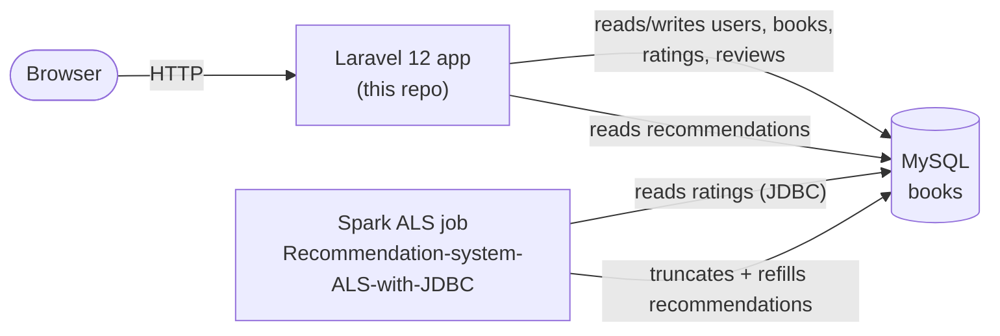

# Readit

**A Goodreads-style book catalogue with personalised recommendations, built with Laravel and fed by a Spark ALS collaborative-filtering job.**

[](https://github.com/muhammedts/Books-recommendation-system-with-sample-UI/actions/workflows/ci.yml)


[](LICENSE)

## What it does

- **Browse and search** the [goodbooks-10k](https://github.com/zygmuntz/goodbooks-10k) catalogue by title or author, with live results as you type and a "most rated" sidebar.
- **Rate books (1-5 stars) and write reviews** once you have an account. Re-rating a book updates your rating instead of adding a new one, and each book's average and rating count are recalculated from the ratings table.
- **Get personal recommendations** on your dashboard, next to the list of books you have rated. They are produced by a separate Spark ALS job that learns from everyone's ratings.
- **Manage the catalogue as an admin**: add, edit and delete books, with an uploaded cover image or a cover URL.
- **Import the real dataset** (10,000 books, up to about 6 million ratings) with a single artisan command.

## Architecture

The web app and the recommender share one MySQL database. Laravel writes `ratings`, the Spark job reads them, trains an ALS model and refills `recommendations`, which Laravel shows on the dashboard.



The recommender lives in its own repository: [muhammedts/Recommendation-system-ALS-with-JDBC](https://github.com/muhammedts/Recommendation-system-ALS-with-JDBC).

### Shared database contract

| Table | Columns | Written by |
| --- | --- | --- |
| `ratings` | `user_id`, `book_id`, `rating` (1-5), timestamps; primary key (`user_id`, `book_id`) | Laravel |
| `recommendations` | `user_id`, `book_id`, `rank`, `score`, `generated_at`; primary key (`user_id`, `rank`) | Spark job |
| `books` | `id` (the goodbooks `book_id`), `title`, `authors`, `isbn`, `original_publication_year`, `language_code`, `image_url`, `average_rating`, `ratings_count` | Laravel |

## Tech stack

- PHP 8.3, Laravel 12 (Eloquent, Form Requests, policies, Blade)
- Bootstrap 5 and Bootstrap Icons (from a CDN, so there is no front-end build step)
- MySQL 8.4 in production, SQLite for tests
- PHPUnit and Laravel Pint, GitHub Actions CI
- Docker (`php:8.3-apache`) and Docker Compose
- Apache Spark ALS for recommendations (separate repository)

## Quick start

### With Docker Compose

```bash
git clone https://github.com/muhammedts/Books-recommendation-system-with-sample-UI.git
cd Books-recommendation-system-with-sample-UI

docker compose up --build -d                                # MySQL + the app on http://localhost:8000
docker compose exec app php artisan db:seed --force         # optional demo data
docker compose exec app php artisan books:import            # optional: the real goodbooks-10k data

docker compose --profile recommender up --build -d          # also start the Spark recommender
```

The app container runs the database migrations on start. Set `APP_KEY` (for example in a `.env` file next to `compose.yaml`) to keep sessions valid across restarts; otherwise a temporary key is generated.

### Without Docker

Requirements: PHP 8.3 with `pdo_mysql` (or `pdo_sqlite`), Composer and MySQL.

```bash
composer install
cp .env.example .env
php artisan key:generate
php artisan migrate --seed      # expects a MySQL database called "books" on localhost:3306 (root, no password)
php artisan storage:link        # serves uploaded covers
php artisan serve               # http://localhost:8000
```

To try it without MySQL, set `DB_CONNECTION=sqlite` in `.env` and remove the other `DB_*` lines; `php artisan migrate` offers to create `database/database.sqlite`.

The seeder creates 30 sample books with ratings and two accounts for **local development only**:

| Email | Password | Role |
| --- | --- | --- |
| `admin@example.com` | `password` | admin (can add, edit and delete books) |
| `demo@example.com` | `password` | regular reader |

## Importing the goodbooks-10k data

```bash
php artisan books:import                         # downloads books.csv + the first 100,000 ratings
php artisan books:import --ratings-limit=0       # all ~6 million ratings (slow)
php artisan books:import --books=/data/books.csv --ratings=/data/ratings.csv   # local copies
php artisan books:import --skip-ratings          # catalogue only
```

The command streams the CSV files from [zygmuntz/goodbooks-10k](https://github.com/zygmuntz/goodbooks-10k) (or local paths), bulk-upserts them in chunks (`--chunk=1000`), and recalculates every book's average rating and rating count at the end. Each dataset user becomes a placeholder account (`reader{id}@example.invalid`) that cannot log in. The import is idempotent, so it is safe to run again. Book ids are the goodbooks ids, so import into a fresh database (`php artisan migrate:fresh`) rather than on top of the demo seed.

## How recommendations are generated

1. Users rate books in the web app; each rating is upserted into `ratings`.
2. The [Spark ALS job](https://github.com/muhammedts/Recommendation-system-ALS-with-JDBC) connects over JDBC (`DB_URL=jdbc:mysql://db:3306/books`), trains an alternating-least-squares model on all ratings, and writes the top picks for each user into `recommendations` with their `rank` and `score`. In Docker Compose it runs every `INTERVAL_MINUTES` (15 by default) under the `recommender` profile.
3. The dashboard shows the current user's rows from `recommendations`, joined to `books` and ordered by rank. Until the job has run, users see a short explanation instead.

Laravel never writes to `recommendations`; the Spark job owns that table.

## Running the tests

```bash
composer install
php artisan test        # feature and unit tests on in-memory SQLite
vendor/bin/pint --test  # code style
```

The tests cover browsing and search, rating (including that a forged `user_id` is ignored and re-rating updates the aggregates), reviews, admin-only book management, the dashboard's recommendation order, authentication and the CSV importer. They use small fixture files and never download the dataset.

## Project structure

```text
app/
  Console/Commands/ImportGoodbooks.php   books:import command
  Http/Controllers/                      Book, Rating, Review, Dashboard and Auth controllers
  Http/Requests/                         Form Request validation
  Models/                                Book, Rating, Review, Recommendation, User
  Policies/BookPolicy.php                admin-only create/update/delete
  Support/Goodbooks/GoodbooksCsvReader.php  streaming CSV parser for the dataset
database/
  migrations/                            schema, including the tables shared with Spark
  factories/, seeders/                   demo data
resources/views/                         Blade templates (Bootstrap 5)
public/css/app.css, public/js/app.js     small style additions and live search
public/images/                           carousel images and the cover placeholder
tests/                                   PHPUnit feature and unit tests, CSV fixtures
Dockerfile, compose.yaml, docker/        container setup
.github/workflows/ci.yml                 lint, tests and Docker build
```

## History

Readit started in 2019 as a university project built on Laravel 5.7, with the recommender written in Spark. In 2026 the web app was rewritten on Laravel 12 and PHP 8.3: proper authorization (an `is_admin` flag and a policy instead of a hard-coded user id), ratings and reviews tied to the signed-in user, a single place for rating aggregates, a documented database contract with the Spark job, a dataset importer, tests, Docker and CI.

## Credits

- Book and rating data: the [goodbooks-10k](https://github.com/zygmuntz/goodbooks-10k) dataset by Zygmunt Zajac (zygmuntz).
- [AbdrhmnAns](https://github.com/AbdrhmnAns) co-authored the original project and worked on the Spark recommendation part.
- Carousel images are carried over from the original 2019 project.

## License

Released under the [MIT License](LICENSE).
